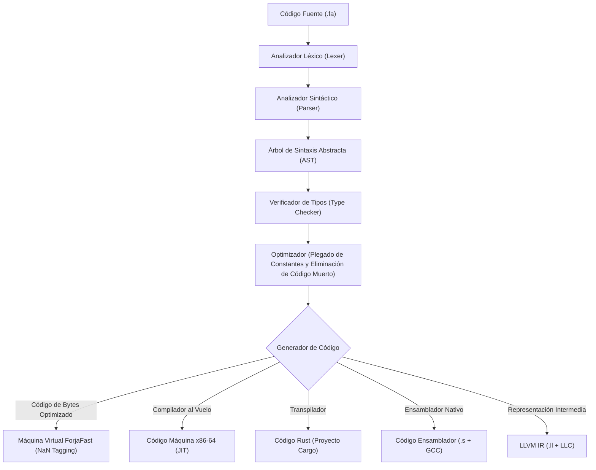

<div align="center">


# Forja (fa)

[](https://github.com/forja-lang/forja/actions)
[](https://forja-lang.github.io/docs)

</div>

Forja es un lenguaje de programación educativo moderno con sintaxis y palabras clave completamente en español. Está diseñado para enseñar conceptos de sistemas, teoría de lenguajes de programación y diseño por contrato sin la complejidad sintáctica de Rust. Incluye un compilador nativo (AOT y ensamblador x86-64/ARM64), un compilador al vuelo (JIT *tiered*) para x86-64, un intérprete de bytecode (*ForjaFast*), transpilación a Rust y a WASM, y soporte de interfaces gráficas nativas.

**[Leé la documentación oficial aquí](https://forja-lang.github.io/docs)**

---

## Arquitectura del Compilador e Intérprete

El siguiente diagrama detalla cómo se procesa el código fuente de Forja hasta sus distintos entornos de ejecución:



> **Pipeline canónico:** la ruta de bytecode tiene un único punto de entrada documentado,
> `compilar_pipeline_completa()` (con imports: `compilar_pipeline_completa_desde()`), que delega
> en el núcleo `compilar_pipeline_nucleo()`. Los nombres antiguos `compilar_con_ir()` y
> `compilar_pipeline()` quedan como aliases `#[deprecated]` que sólo delegan. La ruta de
> transpilación a Rust es independiente y no genera bytecode: `transpilar_a_rust()` (antes
> `compilar()`) y `transpilar_a_rust_con_ast()` (antes `compilar_con_ast()`).

---

## Sintaxis del Lenguaje por Ejemplo

### 1. Variables, Constantes y Tipos Básicos
```forja
// Las variables son mutables por defecto usando 'variable' o 'var'
variable edad = 18
edad = 19 // Permitido

// Las constantes son inmutables usando 'constante' o 'const'
constante pi = 3.14159
// pi = 3.2 // Error en tiempo de compilación
```

### 2. Control de Flujo (Condicionales y Bucles)
```forja
// Condicional clásico
si (edad >= 18) {
    escribir("Sos mayor de edad")
} sino {
    escribir("Sos menor de edad")
}

// Bucle condicional
variable contador = 0
mientras (contador < 3) {
    escribir("Contador: " + contador)
    contador = contador + 1
}

// Bucle determinado
para (variable i = 0; i < 5; i = i + 1) {
    escribir("Iteración: " + i)
}
```

### 3. Interpolación de Cadenas
Forja interpola expresiones con `${...}`. Las llaves sueltas son caracteres literales:
```forja
variable nombre = "Mundo"
variable edad = 25

// Interpolación con dólar-llave
escribir("Hola ${nombre}, tenés ${edad} años")
escribir("Resultado: ${2 + 3}")

// Las llaves sueltas se imprimen literalmente (útil para JSON/plantillas)
escribir("JSON: {\"clave\": \"valor\"}")
```

### 4. Acceso a Mapas con Sintaxis de Punto
```forja
variable config = {"host": "localhost", "puerto": 8080}

// Acceso con punto (equivale a config["host"])
escribir(config.host)    // → "localhost"
escribir(config.puerto)  // → 8080
```

### 5. Métodos Integrados en Tipos Primitivos
```forja
// Métodos de Texto
variable txt = "hola mundo"
escribir(txt.longitud())       // → 10
escribir(txt.a_mayusculas())   // → "HOLA MUNDO"
escribir(txt.a_minusculas())   // → "hola mundo"
escribir(txt.contiene("mundo"))// → verdadero

// Métodos de Arreglo
variable nums = [1, 2, 3]
nums.empujar(4)
escribir(nums.longitud())      // → 4
```

### 6. Inicialización Struct-Literal
```forja
clase Persona {
    nombre
    edad
}

// Inicialización con llaves (sin constructor manual)
variable p = nuevo Persona { nombre: "Ana", edad: 25 }
escribir(p.nombre) // → "Ana"

// También funciona la forma clásica con constructor
variable q = nuevo Persona("Juan", 30)
```

### 7. Operador Ternario
```forja
variable edad = 20
variable mensaje = edad >= 18 ? "Mayor" : "Menor"
escribir(mensaje) // → "Mayor"
```

### 8. Funciones y Diseño por Contrato (Design by Contract)
Forja implementa el paradigma de diseño por contrato directamente en la firma de las funciones:
```forja
funcion dividir(a: Entero, b: Entero) -> Entero
    requiere b != 0, "No se puede dividir por cero (Precondición)"
    asegura resultado <= a, "El resultado es menor o igual al dividendo (Postcondición)"
{
    retornar a / b
}
```

---

## Consola de Comandos (CLI)

Todos los comandos de la herramienta de consola de Forja aceptan términos y argumentos en español.

### Detección y Configuración Inicial

Para utilizar la herramienta de consola en cualquier directorio, podés configurar un alias o compilar el binario directamente en la carpeta del compilador:

```powershell
# Compilar todas las herramientas en modo optimizado (compilador, depurador, interfaz gráfica y servidor de lenguaje)
PS C:\forja> cargo build --release --features all
```

---

### Referencia de Comandos en Español

| Comando en Consola | Comando Alternativo | Propósito |
| :--- | :--- | :--- |
| **`ejecutar <archivo.fa>`** | `correr` | Compila y ejecuta el script en la máquina virtual *ForjaFast* (por defecto). |
| **`compilar <archivo.fa>`** | `construir` | Genera un ejecutable autónomo nativo. Si usa `importar gui`, usa `forja-rt-gui` (VM + runtime gráfico Xilem). Sin transpilación a Rust. |
| **`interactivo`** | `repl` | Inicia la consola de lectura e interpretación línea por línea. |
| **`probar [archivo.fa]`** | `test` | Corre los módulos de prueba unitaria marcados con `@test`. |
| **`medir <archivo.fa>`** | `benchmark` | Analiza el rendimiento del código (mediciones en frío y en caliente). |
| **`diagrama <archivo.fa>`** | `grafico` | Genera un diagrama en formato Mermaid (.mmd) con la representación del AST. |
| **`formatear <archivo.fa>`** | `fmt` | Aplica una indentación estándar de 4 espacios al código fuente. |
| **`compilar-asm <archivo.fa>`**| `asm` | Genera código de ensamblador nativo para Windows o Linux. |
| **`transpilar <archivo.fa>`** | `transpilador` | Traduce el código de Forja a un proyecto estructurado en Rust. |
| **`documentar <archivo.fa>`** | `doc` | Lee comentarios documentales (`///`) y exporta páginas de ayuda HTML. |
| **`colorear <archivo.fa>`** | `highlight` | Imprime el código fuente con colores ANSI en la terminal. |
| **`nuevo <nombre>`** | `crear` | Crea un nuevo proyecto con estructura estándar y archivos de configuración. |
| **`iniciar`** | `init` | Inicializa un proyecto de Forja en el directorio actual. |
| **`aprender`** | `learn` | Ejecuta el curso y tutorial interactivo del lenguaje. |
| **`explicar <concepto>`** | `explain` | Busca y describe la sintaxis o palabras clave en el glosario. |
| **`palabras`** | `keywords` | Muestra la lista completa de palabras reservadas del lenguaje. |
| **`ayuda`** | `help` | Imprime el manual general de la consola de comandos. |

---

### Ejemplos Prácticos de Consola

Aquí se ilustra cómo interactuar con el compilador en un entorno de comandos típico:

#### 1. Ejecutar un Script en la Máquina Virtual
```powershell
# Ejecución estándar (usa la máquina virtual optimizada ForjaFast por defecto)
PS C:\forja> forja ejecutar ejemplos/01_hola.fa

# Ejecutar con el compilador al vuelo (JIT tiered) nativo
PS C:\forja> forja ejecutar ejemplos/01_hola.fa --vm jit

# (La VM original v1 fue removida en 0.9.0: solo quedan ForjaFast y el JIT.)
```

#### 2. Compilar a un Ejecutable Autónomo Ligero
```powershell
# Compilar script de consola
PS C:\forja> forja compilar ejemplos/05_condicionales.fa -o condicionales.exe
Ejecutable generado: condicionales.exe

# Ejecutar de forma directa e instantánea sin dependencias
PS C:\forja> .\condicionales.exe
Sos mayor de edad
Buen trabajo!
```

#### 3. Realizar una Medición de Rendimiento (Benchmark)
```powershell
# Comparar el script en los dos motores (ForjaFast y JIT)
PS C:\forja> forja medir ejemplos/40_fibonacci.fa --vm todas --iters 100
```

#### 4. Modo Interactivo (Consola de Lectura y Ejecución Directa)
```powershell
PS C:\forja> forja interactivo
Forja v0.9.3 — Escribí 'salir' para terminar
> variable x = 10
> x = x + 5
> escribir(x)
15
> salir
¡Hasta luego!
```

---

## Salidas de Compilación y Motores de Ejecución

Forja genera distintos destinos a partir del mismo programa. Los dos **motores de ejecución** son el intérprete *ForjaFast* y el JIT *tiered*; el resto son backends de traducción:

| Salida / Motor | Tipo | Notas |
| :--- | :--- | :--- |
| **Transpilado a Rust** | Forja → `.rs` + `rustc` | Rendimiento nativo (mismo backend LLVM de Rust) |
| **Ensamblador Nativo** | `.s` x86-64/ARM64 + `gcc -O2` | Multi-arquitectura |
| **Backend LLVM** | LLVM IR + `llc` | En desarrollo |
| **JIT tiered** | Código máquina x86-64 en caliente | Con fallback seguro a la VM |
| **ForjaFast (VM)** | Intérprete de bytecode | Motor por defecto (NaN tagging + GC) |
| **AOT (`forja build`)** | Ejecutable con bytecode incrustado | Autónomo, sin dependencias |

---

## Desarrollo Gráfico (GUI)

Forja permite crear complejas aplicaciones de escritorio reactivas e interactivas gracias a la librería de interfaces gráficas (**Xilem**, sobre Masonry/Winit). Las interfaces siguen la guía de estilo de **Material Design 3 (Material You)**, con soporte automático para modo oscuro y claro según el sistema operativo.

Al compilar un programa que usa GUI (`importar gui`), Forja genera un ejecutable autónomo nativo usando el stub `forja-rt-gui` (VM + runtime gráfico), sin necesidad de transpilar a Rust ni tener Cargo instalado.

```powershell
# Ejecutar un script con GUI (modo nativo)
PS C:\forja> forja ejecutar ejemplos/gui.fa --native

# Compilar a ejecutable autónomo (autocontenido, sin transpilación)
PS C:\forja> forja compilar ejemplos/gui.fa -o miapp.exe
```

---

## Compilación Cruzada para Android

El compilador soporta la generación directa de binarios optimizados para dispositivos Android (arquitecturas ARM64, x86_64, ARM32 y x86):

```bash
# Compilar para todos los dispositivos soportados
$ bash scripts/build-android.sh

# Compilar únicamente para arquitectura ARM64 de 64 bits
$ bash scripts/build-android.sh aarch64-linux-android
```

---

## Estado del proyecto

Forja está en **v0.9.3** y en desarrollo activo. El estado verificable de cada
componente —hecho / en progreso / planeado— vive en el
**[roadmap oficial](https://forja-lang.github.io/docs/roadmap/)**.

- **Motores de ejecución (2):** intérprete *ForjaFast* (`src/vm_fast/`) y JIT *tiered* (`src/jit_tiered.rs`).
- **Frontend reutilizable:** crates `forja-syntax` y `forja-types` (lexer, parser, AST, tipos).
- **Salidas:** bytecode (VM/JIT), ensamblador x86-64/ARM64, Rust, AOT, WASM, Android y GUI.
- **Ecosistema:** `stdlib` (47 módulos), 262 ejemplos, curso de 30 días, LSP + DAP, GC generacional, registro de paquetes local y releases precompilados.
- **En progreso:** IR real (emisión AST→IR), backend LLVM, extracción de `forja-gui-core` y registry remoto.

---

## Licencia y Uso de Marca

*   **Compilador y Herramientas**: Licenciado bajo la **Licencia Pública General de GNU v3.0 (GPLv3)**.
*   **Tus Programas**: Escribir software en Forja no restringe su distribución. **Tus aplicaciones son de tu propiedad exclusiva** y podés elegir la licencia comercial o de código abierto que prefieras.